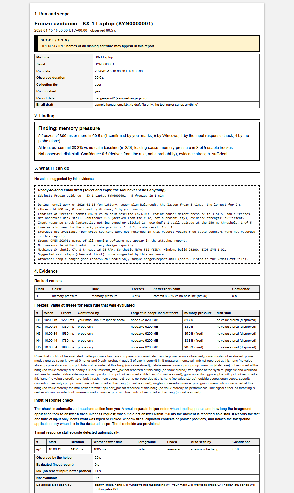
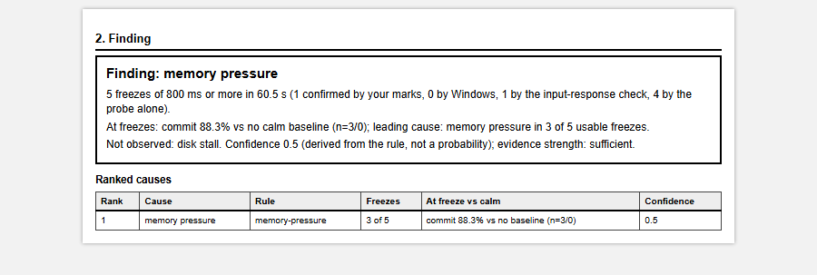
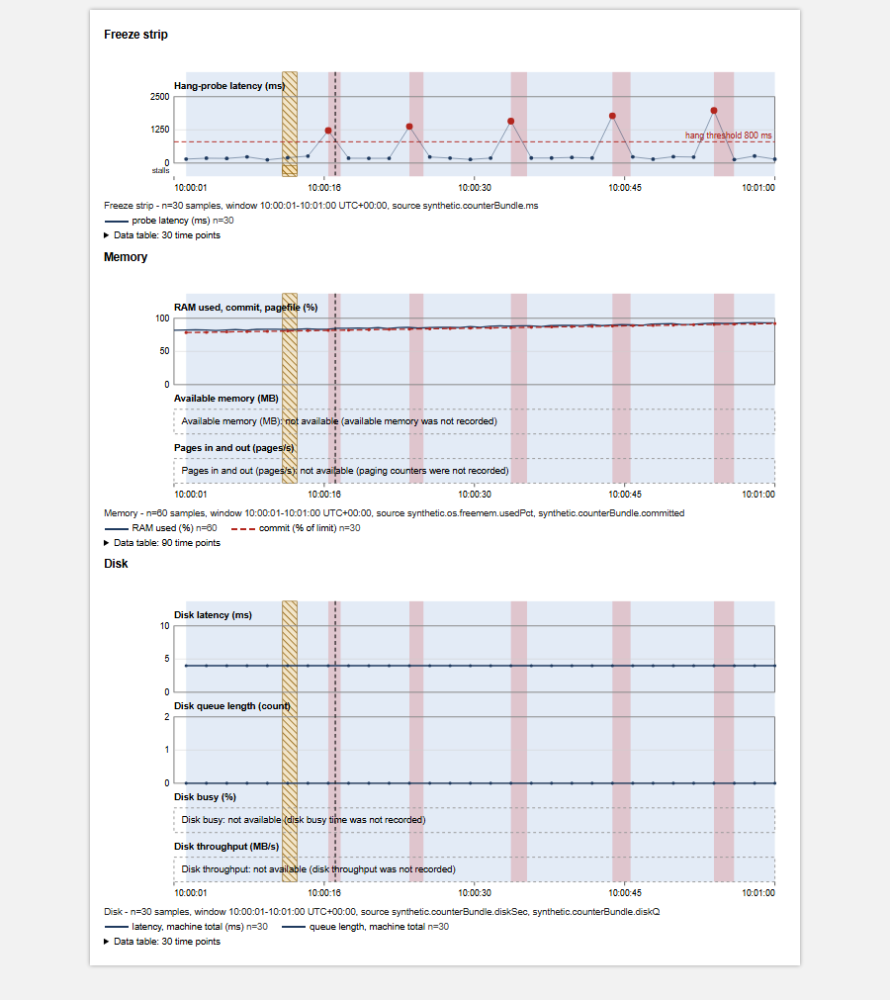
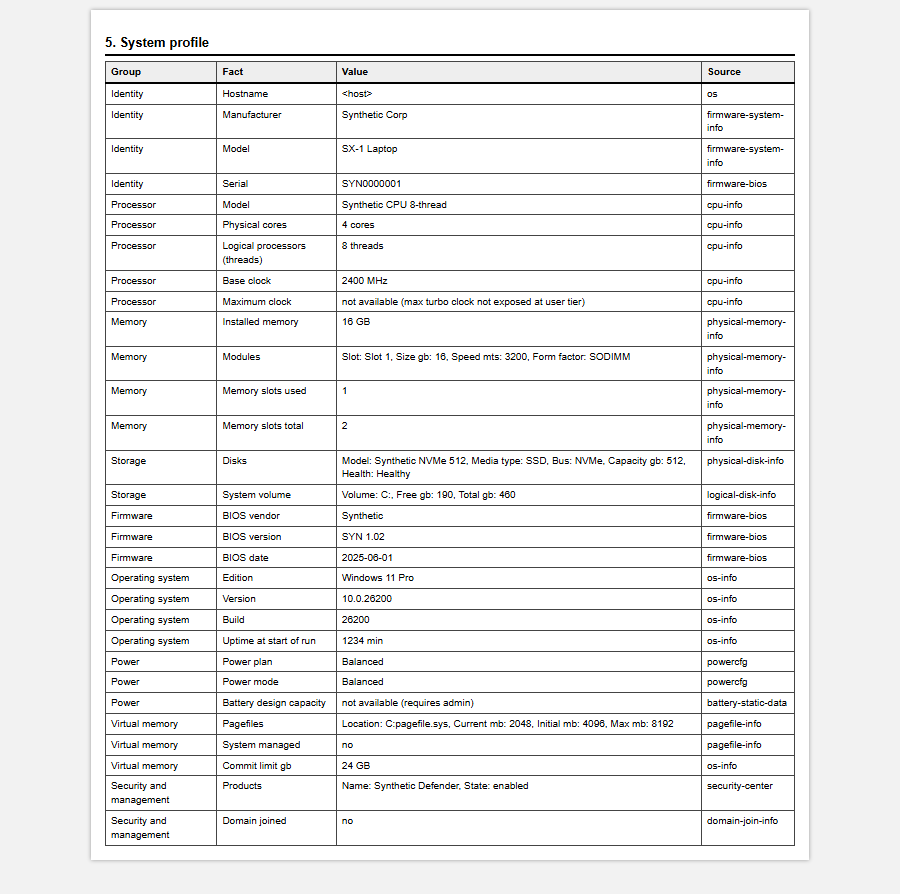
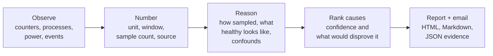
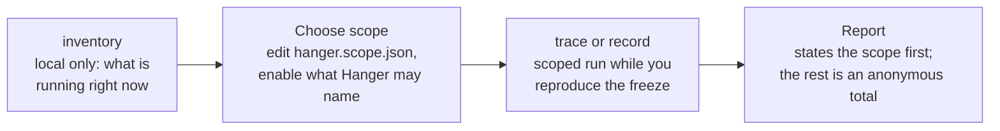

<div align="center">


**Hang evidence, captured while it happens.**

[](LICENSE)


</div>

## The 10-second pitch

A developer's machine freezes for a few seconds, now and then, and it never does it when someone is watching. IT cannot see it from their desk, and the first ticket rarely holds enough to act on, so the thread turns into rounds of "can you send the OS build... what was running... how often?".

**Hanger is a small Windows tool the developer runs on their own machine while they reproduce the freeze.** It records what the machine is doing, notices the hang, works out the candidate causes, and writes a report and an email draft with the system profile, the numbers at the freeze versus calm periods, and the gaps. The first ticket already contains what IT needs.

The hang is the shared problem. Hanger is how both sides get the same facts.

## Why

- **IT needs evidence it can check.** Machine model and serial, RAM, disk, OS build, power plan, what was running, how long and how often it froze, and what was *not* measurable and why. Not a screenshot of Task Manager.
- **Developers need a way to hand that over without a project.** One command, no admin, no install, no account. Work normally; the report comes out the other end.
- **Both need honesty.** Hanger gives evidence, not verdicts. It ranks candidate causes with a stated confidence and a "what would disprove this" line, and it says `no-freeze-observed` when it did not see one.

### How it is deployed

**Collection on request.** IT asks a developer to run it; the report comes back complete. There is no fleet rollout, no agent, no telemetry, nothing leaves the machine until a person sends the files, there are zero dependencies, and privacy is by declared scope. Hanger never tells anyone what to buy, and it does not decide who gets which machine.

## What the report looks like

All screenshots are from a **synthetic** sample ([`reports/sample-hanger.report.html`](reports/sample-hanger.report.html)); no real machine data.

<p align="center">
  <a href="docs/img/report-full.png"></a>
</p>
<p align="center"><em>The report, first page: run and scope first, then the finding, what IT can do, and the evidence.</em></p>

<p align="center">
  
</p>
<p align="center"><em>The finding card: what was observed, at-freeze versus calm numbers, and a ranked cause list with derived confidence.</em></p>

<p align="center">
  
</p>
<p align="center"><em>Charts share one clock, so a freeze lines up with memory, CPU, clock and disk. The report is plain HTML and SVG and prints without script.</em></p>

<p align="center">
  
</p>
<p align="center"><em>The system profile: the facts IT would otherwise ask for, with the source and tier of each. Anything that could not be read says why instead of showing a zero.</em></p>

Also in the repo: [Markdown version](reports/sample-hanger.md), [JSON evidence](reports/sample-hanger.json), and the [email draft](reports/sample-hanger.email.txt).

## Try it in 2 minutes

Requires Windows 10 or 11, Node 18+ and PowerShell 5.1. No admin and no `npm install`.

```powershell
git clone https://github.com/sheriffabdullah/hanger.git
cd hanger

node tools/hanger/hanger.js watch --watch-secs 10            # 10 s sanity check
node tools/hanger/hanger.js inventory --write-scope          # what is running? (local only)
# edit hanger.scope.json: set "enabled": true on what you want monitored
node tools/hanger/hanger.js trace --duration 120 --anonymize # work normally while it records
```

Tap any key the moment it freezes to leave a mark. A run writes files you can hand to IT:

| File | What it is |
|---|---|
| `hanger-<stamp>.report.html` | Print-ready report with charts (opens with scope, then the finding) |
| `hanger-<stamp>.md` | Same content as Markdown |
| `hanger-<stamp>.email.txt` | Ready-to-send message; every number is checked against the JSON |
| `hanger-<stamp>.json` | The evidence (schema `hanger-json/2`, frozen) |
| `hanger-<stamp>.jsonl` | Append-only stream written as it measures, so a crash loses nothing |

## How it works



Raw observations become numbers, numbers become a reasoned cause list, and presentation is only a renderer. Second-order results never overwrite first-order data, and thresholds are recorded in the report so a recompute reproduces it.

### Baseline, then scope, then a scoped run



## What IT gets

- **A complete first ticket**: HTML/Markdown report, JSON evidence and an email draft.
- **System profile** with the source and tier of every fact; unavailable facts say why.
- **A hang table**: when, how long, what was in the foreground scope, and how each freeze was corroborated (probe, your mark, Windows "not responding", the input-response check).
- **At-freeze versus calm numbers** from the same run, so load-linked is distinguishable from always-slow.
- **Ranked candidate causes** with a derived confidence and a disprover for each.
- **A scope audit**: declared scope source, file path and SHA-256, entries, match rule, the always-monitored system set, and the out-of-scope load as counts only.
- **Honest gaps**: every signal that could not be collected, with the reason.
- **Suggested checks** (cheapest first, each tied to the rule that raised it). Never purchase advice.

## What developers do

1. Get the scope file or agree one with IT (or run `inventory` and pick what Hanger may name).
2. Run `trace` (or `record`) while working normally and reproducing the freeze. Tap a key when it happens.
3. Read the report once, then send the HTML or Markdown and the email draft. That is the whole job.

## What it captures

| Area | Signals |
|---|---|
| Memory | RAM used, commit and commit limit, available memory, paging rate, pagefile use and placement, modified list |
| CPU | Total and per-process CPU, run queue, DPC and interrupt time, clock and throttling |
| Disk | Latency and queue per drive, free space, pagefile and workload placement |
| Power and heat | AC/battery, power plan, battery percent, temperature (some need admin) |
| GPU and network | Engine utilization and dedicated memory, network counters |
| Workload | Docker and WSL2 memory over time, configured WSL limits, workload phases (idle vs loaded) |
| Hangs | Spawn-probe latency, your key marks, Windows "not responding" and app-hang events, an automatic input-response check |
| System profile | Processor, OS build, RAM, disk type, GPU, BIOS, power plan, security products, WSL limits |

## Privacy by declared scope

Privacy here is **declared scope, not redaction**. Run an inventory, choose what Hanger may name, and run again scoped to that. Software outside the scope is recorded only as an anonymous total (counts and memory), never written to disk, logs or the console, and every report opens by stating the scope. `--anonymize` additionally scrubs hostnames, usernames and paths.

- The input-response check records only the fact and time of input and how long the foreground application took to answer. It never reads what you type or click, window titles, clipboard contents or pointer positions.
- Nothing is sent anywhere. Hanger makes no network calls of its own and has no telemetry.
- A privacy canary test plants a secret and fails the build if any artifact names software outside the declared scope.
- Hidden or unsanctioned software is a deliberate non-goal: Hanger only sees what the developer declares, and is not a compliance scanner.

## How the diagnosis works

Each rule (memory and commit pressure, hard-fault thrash, CPU saturation, security-software contention, thermal and power throttling, Docker/WSL memory, database settings, a single dominant process, driver interrupts, GPU contention, disk stall, disk nearly full) is judged **at each freeze against calm periods in the same run**. Each produces a candidate cause with:

- a **derived confidence** (from the rule, not a probability),
- the **values at freeze versus calm**, with sample counts,
- a **"what would disprove this"** line and the confounds that could explain it away.

If nothing is supported the finding is `no-freeze-observed` or `insufficient-evidence`, never a guess. The output is evidence for a person to judge, not a verdict. Details: [user guide](docs/USER-GUIDE.md) and [product manifesto](PRODUCT_MANIFESTO.md).

## FAQ

**Does it phone home?** No. There is no telemetry and no network call of its own. Files stay on the machine until someone sends them.

**Does it need admin?** No. Admin unlocks a few extra signals (some temperatures, disk health, firmware details); without it those show as unavailable with a reason.

**Will security software flag the helper?** Possibly. The input-response check uses a tiny helper compiled locally. If a security product blocks it, Hanger falls back to the other signals and the report says the check was unavailable and why.

**Mac or Linux?** Not yet. Windows 10/11 only; `check-stub` defines the contract a port would have to meet.

**Is it a fleet agent?** No. It is collection on request: one developer, one machine, one run.

**Does it tell us what to buy?** No, and it will not. It reports evidence and suggested checks.

## Status

Early beta. Be clear-eyed about what is validated:

- Real-hang diagnosis is validated on **fixtures** (synthetic and recorded scenarios), not yet on a broad set of real machines. That is exactly what we want feedback on.
- The Docker and Postgres signals are validated against **canned command outputs** only, not against live containers across setups.
- The privacy canary and the full test suite (zero dependencies, `node --test`) pass, and the specs validate with OpenSpec.

## Roadmap

- A global **hang-mark shortcut**, so you can mark a freeze from any application.
- **Docker and Postgres validation** against live containers.
- A **signed helper**, to reduce security-product friction.
- A **Mac / Linux port** behind the existing `check-stub` contract.

## Early feedback wanted

> **We are looking for people to try this on a machine that really freezes.** Three things we most want to learn:
>
> 1. **Does the report give IT what they need?** What would still have required a follow-up question?
> 2. **Wrong diagnoses.** Did it rank a cause that turned out not to be the cause, or miss the real one?
> 3. **Missing signals.** What would have explained the hang that the report did not contain?
>
> Open an issue with the [hang report](../../issues/new?template=hang-report.yml), [wrong diagnosis](../../issues/new?template=wrong-diagnosis.yml) or [missing signal](../../issues/new?template=missing-signal.yml) template. Please keep real hostnames, usernames and serial numbers out of anything you paste.

## Documentation

- [User guide](docs/USER-GUIDE.md): modes, scope, signals, diagnosis, outputs and the input-response check
- [Product manifesto](PRODUCT_MANIFESTO.md): what it is, what it refuses to be
- [Schema changelog](tools/hanger/SCHEMA-CHANGELOG.md) and [metric registry](METRIC_REGISTRY.md)
- [Specifications](openspec/specs/): the requirements, written with OpenSpec

## Contributing

Contributions are welcome. Read [CONTRIBUTING.md](CONTRIBUTING.md) first: behavior changes start as an OpenSpec change, and the privacy canary must stay green. Please follow the [Code of Conduct](CODE_OF_CONDUCT.md); security issues go through [SECURITY.md](SECURITY.md).

```powershell
node --test tools/hanger/test/        # zero-dependency test suite
node tools/hanger/test/canary-leak.js # privacy canary (expects "canary hits: 0")
openspec validate --all --strict      # spec validation
```

<p align="center"></p>

## License

[MIT](LICENSE)
